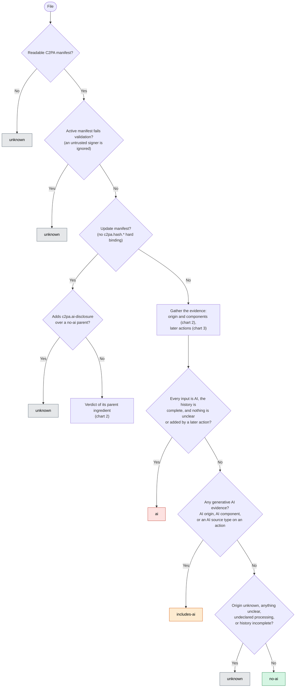
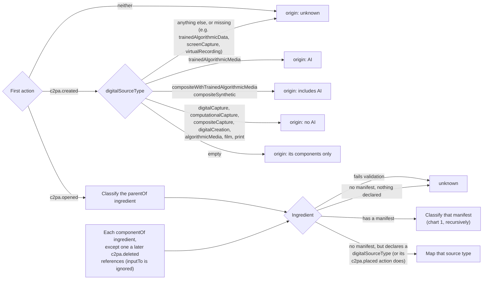
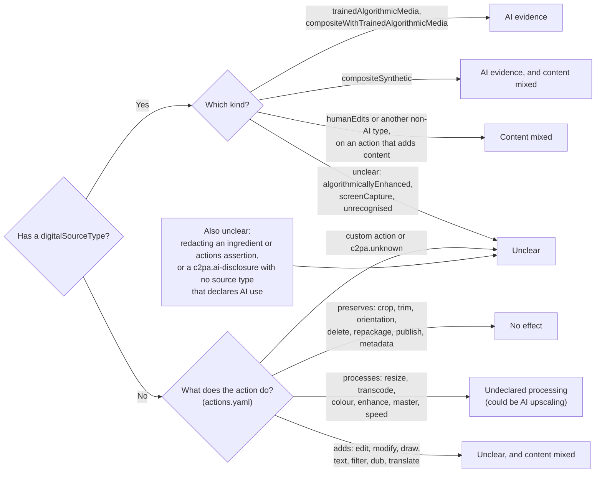

# How the classifier decides

The reference classifier ([`src/classify.rs`](../src/classify.rs)) answers one question: what does
the signed provenance declare about **generative** AI in the current content? These charts follow
the code. [The step-by-step guide](step-by-step-guide.md) explains it in plain language, and
[the policy](../README.md#the-policy) in the README gives the reasons.

## 1. The verdict

"History complete" means every actions assertion is `c2pa.actions.v2` with
`allActionsIncluded: true`. A v1 assertion, or an omitted field, may hide unrecorded actions.

## 2. Origin and ingredients

Actions are first merged as the specification requires: the `*` template, then same-named
templates, then the action itself (`templateParameters` count as `parameters`), and every
`related` action is merged onto its primary action.

## 3. Later actions

Every action after the first, in every actions assertion, created or gathered:

- **AI evidence** makes the result at least includes-ai.
- **Content mixed** stops an AI origin from counting as entirely AI.
- **Unclear** and **undeclared processing** rule out no-ai.
- A `digitalSourceType` on `c2pa.placed` counts unless its component was later deleted.
